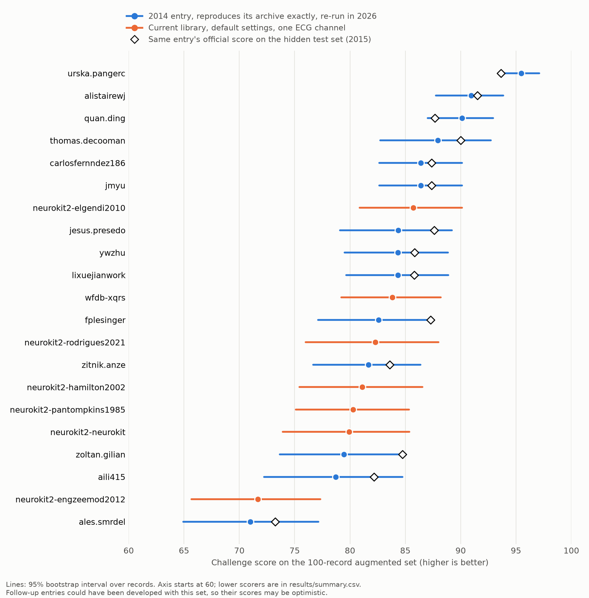

# physio-beat-bench

**Can 12-year-old heartbeat detectors still reproduce their own results?** This repo re-runs all 35 entries with sources in the [PhysioNet/CinC Challenge 2014](https://physionet.org/content/challenge-2014/1.0.0/) archive on a 2026 Mac, and checks each one against the outputs it archived in 2014–15.

| Outcome on the 100 training records | Entries |
|---|---|
| **Exact:** same beat positions on all 100 records | **16** |
| **Near:** same on at least 95 records | 2 |
| **Ran, but differs:** produces output that doesn't match its archive | 12 |
| **Did not run** | 5 |

**The lesson:** 8 of those 12 still score at least 98 on the training set. They look healthy, yet their output isn't what the original produced, so their scores don't measure the original method. Without an archived answer to check against, you would have no way to tell. Failures here mostly show the limits of this revival, not of the original work.

This is research software for benchmarking algorithms. It is not clinically validated and not for patient care.

## What the scores show



Scores on the 100-record augmented set, using the Challenge's official scorer (`bxb -f 0`). Intervals are 95% bootstrap intervals over records. Only entries that reproduce exactly are listed, because a score from any other entry measures our revival rather than the entry.

| Detector | Signals used | Score (95% CI) | Official hidden-test score, 2015 |
|---|---|---|---|
| Pangerc & Jager, entry 420 | ECG + blood pressure | 95.48 (93.56–97.10) | 93.64 |
| Behar, Johnson et al., entry 425 | ECG + blood pressure | 90.96 (87.77–93.85) | 91.50 |
| Ding, entry 454 | ECG + blood pressure | 90.12 (87.02–92.92) | 87.66 |
| De Cooman, entry 420 | ECG + pulsatile signals | 87.93 (82.73–92.72) | 90.02 |
| `gqrs` from WFDB (a 2014 entry is exactly this command) | One ECG | 86.41 (82.63–90.13) | 87.38 |
| NeuroKit2 `elgendi2010` | One ECG | 85.73 (80.87–90.11) | – |
| WFDB `xqrs` | One ECG | 83.83 (79.22–88.20) | – |
| NeuroKit2 default (`neurokit`) | One ECG | 79.92 (73.92–85.35) | – |

Full results: [`results/summary.csv`](results/summary.csv).

**Paired differences** on the 99 records that have an ECG (the first detector minus the second, [`results/comparisons.csv`](results/comparisons.csv)):

| Comparison | Difference (95% CI) |
|---|---|
| Behar, Johnson et al. − `gqrs` | +4.36 (1.20 to 7.88) |
| Behar, Johnson et al. − NeuroKit2 `elgendi2010` | +5.05 (1.11 to 9.35) |
| `gqrs` − WFDB `xqrs` | +2.61 (0.38 to 5.11) |
| `gqrs` − NeuroKit2 `elgendi2010` | +0.69 (−2.30 to 3.78) |
| `gqrs` − NeuroKit2 default | +6.56 (2.78 to 10.83) |

**What this supports, on this noisy ICU dataset:**
- A leading 2014 multimodal detector (Behar, Johnson et al.) still beats the best single-channel library default tested, and the plain `gqrs` baseline.
- A library's default isn't its best method. NeuroKit2's `elgendi2010` scores 5.87 (2.21 to 10.61) above its own default here.
- No current single-channel default tested here beats the plain `gqrs` baseline. These are defaults, not tuned configurations, on a deliberately hard dataset, so this says nothing about clean recordings or about what the libraries can do when configured for this data.

**Does the pipeline measure the right thing?** Across the 16 exact entries, augmented-set scores correlate with the official hidden-test scores: Pearson 0.994, Spearman 0.976. Two very low scorers inflate the Pearson figure; among the 14 scoring above 60, it is 0.944.

**Read the top score with care.** Pangerc's sources are dated February 2015, and the augmented set was released in January 2015, so that entry could have been developed with this set available. Its 93.64 on the hidden set is the more independent number. The hidden test set isn't public, and its 200 records aren't the same as these 100, so the two columns are not directly comparable.

## Reproduce it

Requires macOS on Apple Silicon, [Homebrew](https://brew.sh) and [uv](https://docs.astral.sh/uv/). About 25 minutes on an M5 MacBook Pro, plus the download.

```bash
git clone https://github.com/nicoladelbene/physio-beat-bench
cd physio-beat-bench
uv sync --extra modern --group dev
./scripts/setup_macos.sh                         # native tools; builds WFDB 10.7.0
export WFDB_HOME="$PWD/data/tools/wfdb"
uv run physio-beat-bench fetch                   # ~600 MB from PhysioNet
uv run pytest -q
uv run physio-beat-bench modern
uv run physio-beat-bench entries
uv run physio-beat-bench report
```

Records and entries are downloaded from PhysioNet and never redistributed here. This repo holds only original code and per-record counts.

## How it works

```
PhysioNet archive ─► fetch ─► records + 35 entry archives
                                    │
    setup.sh + next.sh, sandboxed ◄─┤
    no network, writes only to its  │
    work folder, no reference       │
    labels, no archived outputs     │
                │                   │
                ▼                   ▼
          2026 beats ─► compare with archived beats ─► reproduction tier
                │
                └─► bxb -f 0 ─► per-record counts ─► score + bootstrap interval
```

Entries run through their original `setup.sh` and `next.sh`, and **their source code is not modified**. The changes around them are all in [`compat/`](compat/):

- **Compiler flags** accept 2014-era C, with `-ffp-contract=off` so arithmetic isn't silently rearranged.
- **Octave shims** replace the bundled 2014 WFDB toolbox, whose Linux native libraries don't load here, with calls to the native WFDB tools. Newly written, and tested by round trip.
- **Small Linux-to-macOS adapters** cover `sed -i`, `tac` and `wfdb2mat`'s report format, and a 2014-era `mean`, `nanmean` and friends that Octave 11 changed or dropped.
- **Linux-only prebuilt binaries and `.o` files are deleted** so `make` rebuilds them, and the bundled toolbox wrappers are removed so the shims apply.

Those changes could in principle alter results. That's precisely what the comparison with the archive detects, and why it decides what gets reported.

## Limitations

- **One platform, one run.** macOS on Apple Silicon only, with Octave 11 rather than the 2014 version. Run-to-run determinism has not been separately tested. Linux support is next.
- **Exact reproduction is checked on the training set only**, because that's all entries archived. A pass there doesn't prove identical behaviour on the augmented set.
- **The augmented set was public while follow-up entries were developed**, so it isn't a clean held-out test for them.
- **Beat labels are the Challenge's.** They are the reference here, not independently verified.
- **Library defaults only.** This isn't a tuned comparison, and the libraries are not at fault for lacking a second signal.
- **Benchmark scores are not clinical performance.** Nothing here supports clinical use or a claim about patient outcomes.
- **Record 42878 has no ECG.** Under the Challenge rule, ECG-only detectors score zero on it, so they're also compared on the other 99 records above.
- **`fetch` was not exercised end to end.** PhysioNet returned HTTP 500 during final verification, so the fresh-clone run used an identical local copy of the archive. Everything else ran from a clean clone.

## Roadmap

- Linux and container support, plus a determinism check
- Bring back more of the 19 entries that didn't reproduce, keeping the archive as the only test of success
- Tuned library configurations as a separate, clearly labelled comparison
- A leave-records-out evaluation for any method tuned on this data

## How this was built

Designed and reviewed by Nicola Del Bene, and written with substantial help from an AI coding agent (Claude Code), with commits marked accordingly. The agent made real mistakes along the way, including a shim bug that silently corrupted every Octave entry's output. The archive comparison and round-trip tests are what exposed it, which is the reason this project relies on checks rather than on who or what wrote the code.

## References and credits

All detection methods belong to their authors, listed in each entry's `AUTHORS` file in the PhysioNet archive. The entry IDs in `results/` come from the [published rankings](https://physionet.org/content/challenge-2014/1.0.0/).

- [PhysioNet/CinC Challenge 2014](https://moody-challenge.physionet.org/2014/) rules, rankings and data, published under the [Open Data Commons Attribution License v1.0](https://physionet.org/content/challenge-2014/1.0.0/)
- Moody et al., [Robust detection of heart beats in multimodal data](https://lcp.mit.edu/pdf/MoodyCinC2014.pdf), Computing in Cardiology 2014
- Johnson, Behar, Andreotti, Clifford, Oster, [Multimodal heart beat detection using signal quality indices](https://integ04-cnspfv.archimed.fr/doc/OAI_1/oai-HAL-hal-01730819v1), Physiological Measurement 2015
- [WFDB Software Package](https://github.com/bemoody/wfdb) 10.7.0, [wfdb-python](https://github.com/MIT-LCP/wfdb-python), [NeuroKit2](https://github.com/neuropsychology/NeuroKit)

Code in this repo: [MIT](LICENSE). Challenge entries keep their authors' own terms and aren't included here.
