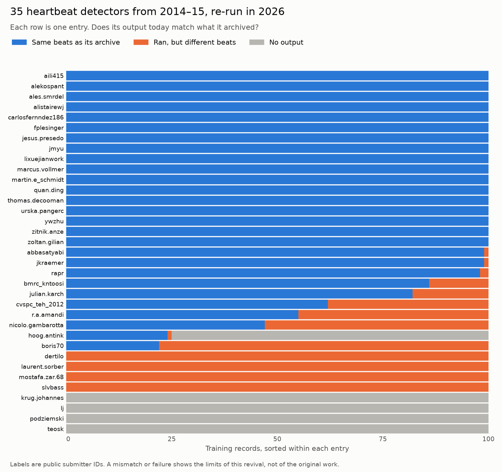

# physio-beat-bench

**Can 12-year-old heartbeat detectors still reproduce their own results?** This repo re-runs all 35 entries with sources in the [PhysioNet/CinC Challenge 2014](https://physionet.org/content/challenge-2014/1.0.0/) archive on a 2026 Mac, and checks each one against the outputs it archived in 2014–15.

> **The remote download is unverified.** PhysioNet's servers returned HTTP 500 for this archive during every final check, so `physio-beat-bench fetch` has not been tested end to end. The published results and the clean-clone run used a local copy of the archive; see [Reproduce it](#reproduce-it).

| Outcome on the 100 training records | Meaning | Entries |
|---|---|---|
| **Exact** | Same beat positions as its archive on all 100 records | **17** |
| **Near** | Same on at least 95 records, but not all | 3 |
| **Ran, but differs** | Produced output on at least one record, and matches on fewer than 95 | 11 |
| **Did not run** | Produced no output on any record | 4 |

One of the 11 that differ, `hoog.antink-407`, produced output on only 25 records, so it's partly an execution failure. Every entry is listed in [`results/reproduction.csv`](results/reproduction.csv).



**The lesson:** 7 of those 11 still score at least 98 on the training set. They look healthy, yet their output isn't what the original produced, so their scores don't measure the original method. Without an archived answer to check against, you would have no way to tell. Failures here mostly show the limits of this revival, not of the original work.

This is research software for benchmarking algorithms. It is not clinically validated, doesn't establish clinical performance, and is not for patient care. It's a personal project, not affiliated with, sponsored by or endorsed by any employer.

## What the scores show


Scores on the 100-record augmented set, using the Challenge's official scorer (`bxb -f 0`). Intervals are 95% bootstrap intervals over records. Only the top entries that reproduce exactly are listed here, plus the `gqrs` baseline, because a score from any entry that doesn't reproduce measures our revival rather than the entry. **These are descriptive scores, not a ranking of methods:** see [How far the comparisons go](#how-far-the-comparisons-go).

| Detector | Signals used | Score (95% CI) | Official hidden-test score, 2015 |
|---|---|---|---|
| Pangerc & Jager, entry 420 | ECG + blood pressure | 95.48 (93.56–97.10) | 93.64 |
| Vollmer, entry 402 | ECG + blood pressure | 91.46 (87.98–94.47) | 89.55 |
| Behar, Johnson et al., entry 425 | ECG + blood pressure | 90.96 (87.77–93.85) | 91.50 |
| Ding, entry 454 | ECG + blood pressure | 90.12 (87.02–92.92) | 87.66 |
| De Cooman, entry 420 | ECG + pulsatile signals | 87.93 (82.73–92.72) | 90.02 |
| `gqrs` from WFDB (a 2014 entry is exactly this command) | One ECG | 86.41 (82.63–90.13) | 87.38 |
| NeuroKit2 `elgendi2010` | One ECG | 85.73 (80.87–90.11) | – |
| WFDB `xqrs` | One ECG | 83.83 (79.22–88.20) | – |
| NeuroKit2 default (`neurokit`) | One ECG | 79.92 (73.92–85.35) | – |

Full results: [`results/summary.csv`](results/summary.csv).

### How far the comparisons go

**No method is claimed to be better than another.** A fair superiority test isn't possible with this data today, for three reasons:

1. **No shared untouched test set.** The Challenge's hidden set isn't public. The five top entries above have sources dated February–April 2015, after the augmented set's January 2015 release, so they could have been tuned on it. The library defaults couldn't have been. Comparisons between them on this set may favour the entries.
2. **Not like for like.** The multimodal entries use blood pressure as well. The libraries were given one ECG channel, and only their defaults were tested.
3. **The comparisons were chosen after seeing the scores, on reused data.** The same records were used to look, to choose what to compare, and to report. Every interval below is exploratory, including the adjusted ones, which account only for the nine listed and not for the informal choosing among 42 detectors.

**Paired differences**, on the 99 records that have an ECG (first minus second, [`results/comparisons.csv`](results/comparisons.csv)). Adjusted intervals are Bonferroni over these nine.

| Comparison | Difference | 95% interval | Adjusted interval |
|---|---|---|---|
| Pangerc & Jager − Vollmer | +4.06 | 0.76 to 7.70 | −0.39 to 9.59 |
| Vollmer − Behar, Johnson et al. | −0.11 | −3.13 to 2.44 | −4.69 to 3.37 |
| Pangerc & Jager − Behar, Johnson et al. | +3.95 | 1.09 to 7.15 | 0.16 to 8.34 |
| Behar, Johnson et al. − `gqrs` | +4.36 | 1.20 to 7.88 | −0.05 to 9.59 |
| Behar, Johnson et al. − NeuroKit2 `elgendi2010` | +5.05 | 1.11 to 9.35 | −0.38 to 11.33 |
| `gqrs` − NeuroKit2 `elgendi2010` | +0.69 | −2.30 to 3.78 | −3.53 to 5.31 |
| `gqrs` − WFDB `xqrs` | +2.61 | 0.38 to 5.11 | −0.44 to 6.33 |
| `gqrs` − NeuroKit2 default | +6.56 | 2.78 to 10.83 | 1.49 to 12.79 |
| NeuroKit2 `elgendi2010` − NeuroKit2 default | +5.87 | 2.21 to 10.61 | 0.95 to 12.66 |

**Choosing a method fairly.** `elgendi2010` stands out only because I looked at all six NeuroKit2 methods on this set. To separate choosing from judging ([`results/selection.csv`](results/selection.csv)):

- **Choose on a random half of the augmented records, judge on the other half, 2,000 times:** the chosen method scores 5.42 above the default on unseen records (middle 95% of splits: 1.06 to 9.29), and `elgendi2010` is chosen in 94.5% of splits. That range isn't a confidence interval, because splits overlap. So the difference isn't just an artefact of picking the winner, *within this noisy set*.
- **Choose on the 100 training records instead:** the default (99.85) ranks above `elgendi2010` (99.78), so you would keep the default. The cleaner set doesn't predict what wins on the noisy one.

**What this does support:** on this deliberately hard set, a library's default wasn't its top-scoring option. Results on clean recordings and on this noisy set point in different directions, so a single score doesn't generalise. These defaults weren't tuned, so this says nothing about what the libraries can do when configured for this data.

**Does the pipeline measure the right thing?** Across the 17 exact entries, augmented-set scores correlate with the official hidden-test scores: Pearson 0.993, Spearman 0.971. Two very low scorers inflate the Pearson figure; among the 15 scoring above 60, it is 0.940.

**Read the top scores with care.** Their hidden-set scores are the more independent numbers, and they reorder the table: Behar, Johnson et al. (91.50) rank above Vollmer (89.55), and De Cooman (90.02) above Ding (87.66). The hidden test set isn't public, and its 200 records aren't the same as these 100, so the two columns are not directly comparable.

## Reproduce it

Requires macOS on Apple Silicon, [Homebrew](https://brew.sh) and [uv](https://docs.astral.sh/uv/). About 30 minutes on an M5 MacBook Pro, plus the download.

```bash
git clone https://github.com/nicoladelbene/physio-beat-bench
cd physio-beat-bench
uv sync --extra modern --group dev
./scripts/setup_macos.sh                         # native tools; builds WFDB 10.7.0
export WFDB_HOME="$PWD/data/tools/wfdb"
```

Then get the data, one of two ways:

```bash
# A. Download. UNVERIFIED end to end: PhysioNet was returning HTTP 500.
uv run physio-beat-bench fetch                   # ~530 MB

# B. Use a copy of the archive you already have. No network needed. This route is verified.
uv run physio-beat-bench fetch --archive /path/to/challenge-2014.zip
```

Either way, `fetch` prints the archive's SHA-256 and says whether it matches the one behind these results:

`d96fa8fd74a04d3935b1bd8b186c88afc0a4074b29dad9d2b1ba30b68ecab352`

That checksum is of the copy used here. It hasn't been compared with PhysioNet's own checksum list, because the file server was failing. If you get a different archive, your results may differ.

Then run everything:

```bash
uv run pytest -q
uv run physio-beat-bench modern
uv run physio-beat-bench entries
uv run physio-beat-bench report
```

PhysioNet has reported slow performance during an infrastructure migration, so route A may fail for a while. Records and entries are never redistributed here. This repo holds only original code and per-record counts.

## How it works

```
PhysioNet archive ─► fetch ─► records + 35 entry archives
                                    │
    setup.sh + next.sh, sandboxed ◄─┤
    no network, no reference labels,│
    no archived outputs, writes to  │
    its work and temp folders only  │
                │                   │
                ▼                   ▼
          2026 beats ─► compare with archived beats ─► reproduction tier
                │
                └─► bxb -f 0 ─► per-record counts ─► score + bootstrap interval
```

Entries run through their original `setup.sh` and `next.sh`, and **their source code is not modified**. The changes around them are all in [`compat/`](compat/):

- **Compiler flags** accept 2014-era C, with `-ffp-contract=off` so arithmetic isn't silently rearranged.
- **Octave shims** replace the bundled 2014 WFDB toolbox, whose Linux native libraries don't load here, with calls to the native WFDB tools. Newly written, and tested by round trip.
- **Small Linux-to-macOS adapters** cover `sed -i`, `tac` and `wfdb2mat`'s report format, and a 2014-era `mean`, `nanmean` and friends that Octave 11 changed or dropped.
- **Linux-only prebuilt binaries and `.o` files are deleted** so `make` rebuilds them, and the bundled toolbox wrappers are removed so the shims apply.

The sandbox blocks reads of reference labels (`.atr`), archived outputs (`challenge/` folders) and Challenge archives (`.zip`) anywhere on disk, in `setup.sh` as well as `next.sh`. Regression tests check this with fake entries and on the real data layout, with a positive control. An independent review found gaps in earlier versions, now closed. Entries may still write to the system's per-user temp folder as well as their own work folder, and they can read other files on the machine, so it protects the results rather than the machine: run untrusted code accordingly.

Those changes could in principle alter results. That's precisely what the comparison with the archive detects, and why it decides what gets reported.

## Limitations

- **One platform.** macOS on Apple Silicon only, with Octave 11 rather than the 2014 version. Linux support is next.
- **Not every entry is deterministic here.** `rapr-25` crashes intermittently: a binary segfaults on some runs, and record 1565 scored 0 true positives in one run of five and 697 in the others. Two full runs of the same code, one from a clean clone, agreed on all 8,400 record results except 5 from `rapr-25`, so the published table and tiers didn't change. Two runs on one machine isn't a formal determinism study.
- **Exit codes are recorded but don't decide anything.** Many 2014 scripts exit oddly. `jesus.presedo-15` and `lixuejianwork-15` exit non-zero on all 100 training records yet reproduce exactly. The archive comparison is the test.
- **Exact reproduction is checked on the training set only**, because that's all entries archived. A pass there doesn't prove identical behaviour on the augmented set.
- **The augmented set was public while follow-up entries were developed**, so it isn't a clean held-out test for them.
- **Beat labels are the Challenge's.** They are the reference here, not independently verified.
- **Library defaults only.** This isn't a tuned comparison, and the libraries are not at fault for lacking a second signal.
- **Benchmark scores are not clinical performance.** Nothing here supports clinical use or a claim about patient outcomes.
- **Record 42878 has no ECG.** Under the Challenge rule, ECG-only detectors score zero on it, so they're also compared on the other 99 records above.
- **`fetch` is unverified end to end.** PhysioNet returned HTTP 500 on every attempt during final verification, so the clean-clone run used a local copy of the same archive. Everything after the download ran from a clean clone. Tests that can run on hosted CI were checked without the native tools, but CI itself hasn't run, because nothing has been pushed.
- **Records are treated as independent.** Intervals resample records. Records from one patient, if any, would make them too narrow. Intervals are uncorrected unless labelled adjusted.

## Roadmap

- Linux and container support, plus a determinism check
- Bring back more of the 18 entries that didn't reproduce, keeping the archive as the only test of success
- Tuned library configurations as a separate, clearly labelled comparison
- A leave-records-out evaluation for any method tuned on this data

## How this was built

**Nicola Del Bene** chose the research question and set the project's direction, drawing on a background in biomedical engineering, and reviewed the results and what they claim.

**Claude Code**, an AI coding agent, substantially assisted with implementation, testing and documentation, and commits are marked accordingly. Most of the code here wasn't written by hand.

The agent made real mistakes along the way, including a shim bug that silently corrupted every Octave entry's output. The archive comparison and round-trip tests are what exposed it. A code review also found that the sandbox didn't block everything this README claimed, which led to the isolation tests. This is why the project relies on checks rather than on who or what wrote the code.

## References and credits

All detection methods belong to their authors, listed in each entry's `AUTHORS` file in the PhysioNet archive. The entry IDs in `results/` come from the [published rankings](https://physionet.org/content/challenge-2014/1.0.0/).

- [PhysioNet/CinC Challenge 2014](https://moody-challenge.physionet.org/2014/) rules, rankings and data, published under the [Open Data Commons Attribution License v1.0](https://physionet.org/content/challenge-2014/1.0.0/)
- Silva, Moody, Behar, Johnson, Oster, Clifford, Moody, [Robust detection of heart beats in multimodal data](https://doi.org/10.1088/0967-3334/36/8/1629), Physiological Measurement 2015
- Johnson, Behar, Andreotti, Clifford, Oster, [Multimodal heart beat detection using signal quality indices](https://doi.org/10.1088/0967-3334/36/8/1665), Physiological Measurement 2015
- [WFDB Software Package](https://github.com/bemoody/wfdb) 10.7.0, [wfdb-python](https://github.com/MIT-LCP/wfdb-python), [NeuroKit2](https://github.com/neuropsychology/NeuroKit)

Code in this repo: [MIT](LICENSE). Challenge entries keep their authors' own terms and aren't included here. The per-record counts in `results/` are derived from the Challenge data, under its Open Data Commons Attribution License.
